Designing and building apps for iOS &amp; Android

Currently based in Almaty, Kazakhstan

  
  
  

### About me

I'm an app developer from Kazakhstan who designs, builds and publishes native apps for iOS and Android. I care about profitable apps that both work well and look good.

### Apps & projects

- **Tamyr App (2025):** Kotlin based mobile app. Tamyr analyzes blood and urine tests, educates users through articles and gives personalized nutrition recommendations, based on the deficits and personal needs, such as allergies, intolerances, food habits. User needs to register his account and complete a symptom-based questionnaire, then receive a personalized list of recommended lab tests. After, user can upload a PDF or photo of the blood test results. With the usage of AI our app compares the values with the normal indicators depending on age, gender, weight. Then the app gives instructions on how to improve their imbalances. The project won Semifinals at Technovation Girls Kazakhstan 2025. 

### Skills

| Area | Tools and methods |
| --- | --- |
| Platforms | iOS, Android |
| Programming languages | Kotlin, Flatter |
| Development tools | Xcode, Android Studio, VS Code |
| Design | Figma (UI/UX design, prototyping) |
| Local data | SwiftData (iOS), Room (Android) |
| Publishing | App Store, Google Play |
| Spoken languages | English, Russian, German |

